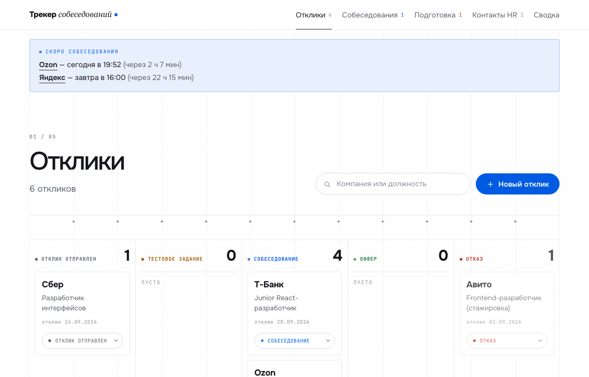

# Трекер собеседований

Лабораторные работы № 1–5 по проектированию и разработке программного обеспечения.

**Вариант 47.** Трекер собеседований: учёт откликов, дат собеседований, задач по подготовке, контактов HR.

**Выполнил:** Лазарев Александр, группа ОИСТ-412.

## Материалы лабораторных работ

| Работа | Результат |
| --- | --- |
| 1. Требования | [Техническое задание](https://github.com/scorpochabro-solo/interview-tracker-srs/wiki/Техническое-задание) и восемь исходных Issues. |
| 2. Планирование | [План проекта](https://github.com/scorpochabro-solo/interview-tracker-srs/wiki/План-проекта) и [Roadmap на 24 задачи](https://github.com/users/scorpochabro-solo/projects/2/views/1). |
| 3. Разработка | [Прототип](https://scorpochabro-solo.github.io/interview-tracker-srs/), [процесс разработки](https://github.com/scorpochabro-solo/interview-tracker-srs/wiki/Процесс-разработки) и [релиз v1.0.0](https://github.com/scorpochabro-solo/interview-tracker-srs/releases/tag/v1.0.0). |
| 4. База данных | [ER-диаграмма](docs/database/er_diagram.png), [SQLite-схема](database/schema.sql), [тестовые данные](database/seed_data.sql) и [нормализация до 3NF](https://github.com/scorpochabro-solo/interview-tracker-srs/wiki/Проектирование-базы-данных). |
| 5. Моделирование поведения | [Use Case и четыре диаграммы последовательности](docs/behavior/README.md). |

## Требования

- [Техническое задание](https://github.com/scorpochabro-solo/interview-tracker-srs/wiki/Техническое-задание) — в Wiki репозитория
- [Задачи (Issues)](https://github.com/scorpochabro-solo/interview-tracker-srs/issues) — требования в виде User Story с критериями приёмки

| Раздел ТЗ | Задача |
|-----------|--------|
| 2.1. Учёт откликов на вакансии | [#1](https://github.com/scorpochabro-solo/interview-tracker-srs/issues/1) |
| 2.2. Статусы откликов | [#2](https://github.com/scorpochabro-solo/interview-tracker-srs/issues/2) |
| 2.3. Собеседования | [#3](https://github.com/scorpochabro-solo/interview-tracker-srs/issues/3) |
| 2.4. Задачи по подготовке | [#4](https://github.com/scorpochabro-solo/interview-tracker-srs/issues/4) |
| 2.5. Контакты HR | [#5](https://github.com/scorpochabro-solo/interview-tracker-srs/issues/5) |
| 2.6. Сводка | [#6](https://github.com/scorpochabro-solo/interview-tracker-srs/issues/6) |
| 3. Требования к надёжности | [#7](https://github.com/scorpochabro-solo/interview-tracker-srs/issues/7) |
| 4–5. Интерфейс и техническое обеспечение | [#8](https://github.com/scorpochabro-solo/interview-tracker-srs/issues/8) |

## Приложение

По ТЗ сделано веб-приложение: **https://scorpochabro-solo.github.io/interview-tracker-srs/**



- **Отклики** — доска с колонками по статусам: «Отклик отправлен», «Тестовое задание», «Собеседование», «Оффер», «Отказ». Статус меняется прямо на карточке, история изменений сохраняется.
- **Собеседования** — дата, время, этап, формат, ссылка на звонок. Если до встречи меньше суток, сверху появляется напоминание.
- **Подготовка** — чек-лист задач к каждому отклику, сроки и просроченные задачи.
- **Контакты HR** — рекрутеры и HR, дата последнего общения, пометка «давно не связывались».
- **Сводка** — статистика по статусам и конверсия в собеседование и оффер.

Данные хранятся только в браузере (localStorage) и никуда не отправляются. Все изменения сохраняются автоматически.

## Запуск

Проще всего открыть ссылку выше. Чтобы запустить у себя:

```bash
git clone https://github.com/scorpochabro-solo/interview-tracker-srs.git
cd interview-tracker-srs
python3 -m http.server 8000 --directory app
```

После этого открыть http://localhost:8000. Просто открыть `app/index.html` двойным щелчком не получится: браузер загружает JS-модули только по http.

## Резервная копия

1. **Сделать копию:** раздел «Сводка» → «Скачать копию». Сохранится файл `interview-tracker-ГГГГ-ММ-ДД.json`.
2. **Восстановить:** раздел «Сводка» → «Загрузить из файла» → выбрать файл → подтвердить замену данных.

Перед загрузкой файл проверяется целиком. Если в нём ошибка, программа покажет, что не так, а текущие данные останутся без изменений.

В папке [`demo`](demo/demo-data.json) лежит пример копии с заполненными откликами — его можно загрузить, чтобы посмотреть трекер с данными.

## Учебная база SQLite

Для четвёртой работы подготовлена отдельная реляционная схема для откликов, компаний, рекрутеров, интервью, задач и истории статусов. Демо продолжает сохранять данные в браузере. Схему можно проверить на отдельной локальной базе.

```bash
sqlite3 -bail interviews.db < database/schema.sql
sqlite3 -bail interviews.db < database/seed_data.sql
python3 -m unittest discover -s tests -p test_database.py -v
```

Требуется SQLite 3.37 или новее. Порядок загрузки и правила связей описаны в [документации по схеме](database/normalization.md).

## Тесты

Нужен Node.js 22 или новее, внешних зависимостей нет.

```bash
npm test
```

Тесты проверяют модель данных, проверку полей, сохранение и загрузку резервной копии, подсчёт статистики и отрисовку разделов (в том числе экранирование введённого текста). Они же запускаются в GitHub Actions перед каждой публикацией.

## Структура

```
app/              приложение: HTML, CSS и JS без сборки и библиотек
  js/model.js     данные и операции над ними
  js/validate.js  проверка полей форм
  js/store.js     сохранение в localStorage, проверка резервной копии
  js/stats.js     сводка
  js/views/       разметка разделов и форм
  js/main.js      обработка действий пользователя
  fonts/          шрифты Onest и JetBrains Mono (SIL OFL 1.1)
tests/            автотесты приложения и базы
demo/             пример резервной копии
database/         схема SQLite и тестовые данные
docs/database/    ER-диаграмма
```
